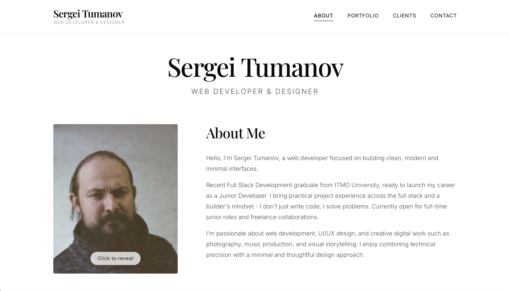

# Sergei Tumanov | Full Stack Web Developer Portfolio



Welcome to my personal portfolio! I am a recent Full Stack Development graduate from ITMO University with a passion for building clean, modern, and user-centric web interfaces. 

This repository contains the source code for my portfolio website, built from the ground up to showcase my journey, skills, and selected projects.

## 🚀 Live Demo
**[View Live Website](https://web.sergeitumanov.com)**

## 👨‍💻 About Me
I am a Junior Full Stack Developer focused on creating minimalist, high-performance web applications. I don't just write code; I solve problems. I bring practical project experience across the full stack, a strong foundation in modern frontend frameworks, and a builder’s mindset. 

I am currently open to **full-time junior developer roles** and **freelance collaborations**.

## 🛠️ Tech Stack
This project was built to demonstrate proficiency in modern web development practices:

*   **Core:** React.js, TypeScript, Vite
*   **Routing:** React Router v6 (Single Page Application architecture)
*   **Styling:** Modern CSS3, CSS Variables, Flexbox, Grid, Responsive Design
*   **Version Control:** Git & GitHub
*   **Architecture:** Component-based design, clean folder structure, reusable UI components

## ✨ Key Features
*   **Single Page Application (SPA):** Smooth, instant page transitions without full browser reloads.
*   **Fully Responsive:** Mobile-first approach ensuring a flawless experience on all devices.
*   **Minimalist UI/UX:** Clean, gallery-style design inspired by modern digital exhibitions.
*   **Interactive Elements:** Custom 3D flip cards, hover animations, and dynamic filtering.
*   **Type Safety:** Built entirely with TypeScript to ensure robust, bug-free code.

## 📂 Project Structure
```text
src/
├── components/   # Reusable UI components (Layout, BackToTop)
├── pages/        # Main route views (Home, Portfolio, Clients, Contact)
├── App.tsx       # Main application component & routing setup
├── App.css       # Global styles and CSS variables
└── main.tsx      # Application entry point
```

## 🏗️ Getting Started (Local Development)
If you'd like to run this project locally or review the code, follow these steps:
1. Clone the repository:
```bash
   git clone https://github.com/SergeiTWeb/web.sergeitumanov.com.git
   cd portfolio
```
2. Install dependencies:
```bash
npm install
```
3. Start the development server:
```bash
npm run dev
```
Open your browser and navigate to http://localhost:5173.
4. Build for production:
```bash
npm run build
```

## 📬 Contact & Connect
I am always eager to connect with fellow developers, recruiters, and potential clients.

Email: [website](https://sergeitumanov.web@gmail.com/)
LinkedIn: [linkedin](https://www.linkedin.com/in/sergei-tumanov/)
GitHub: github.com/SergeiTWeb
If you like this build you can [buy me a coffee](https://www.paypal.com/paypalme/nctmmrn)

Built with ❤️ using React & TypeScript.
